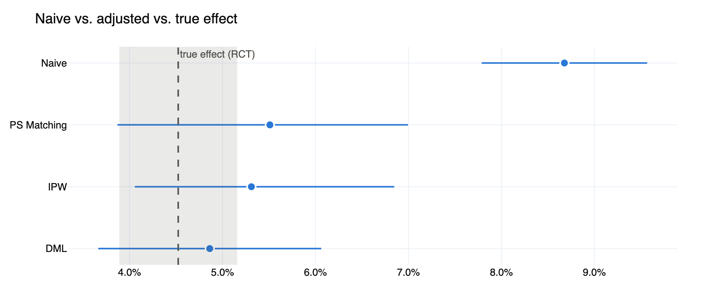
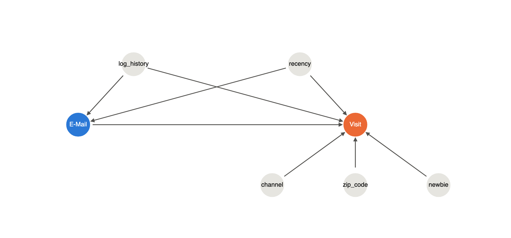
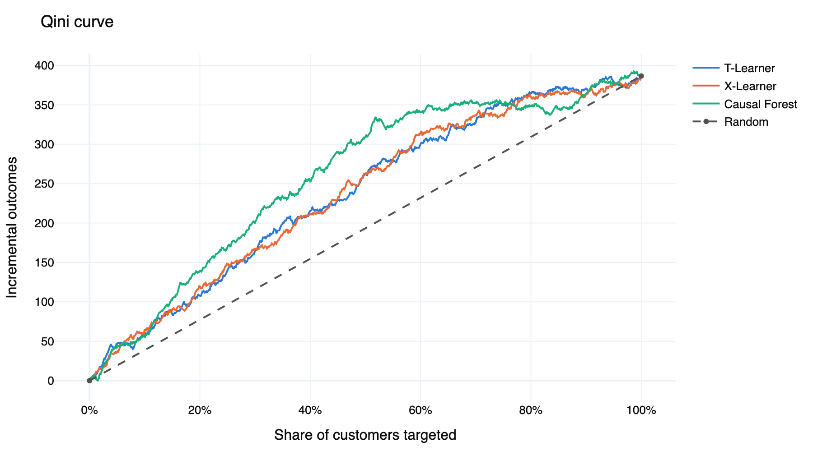
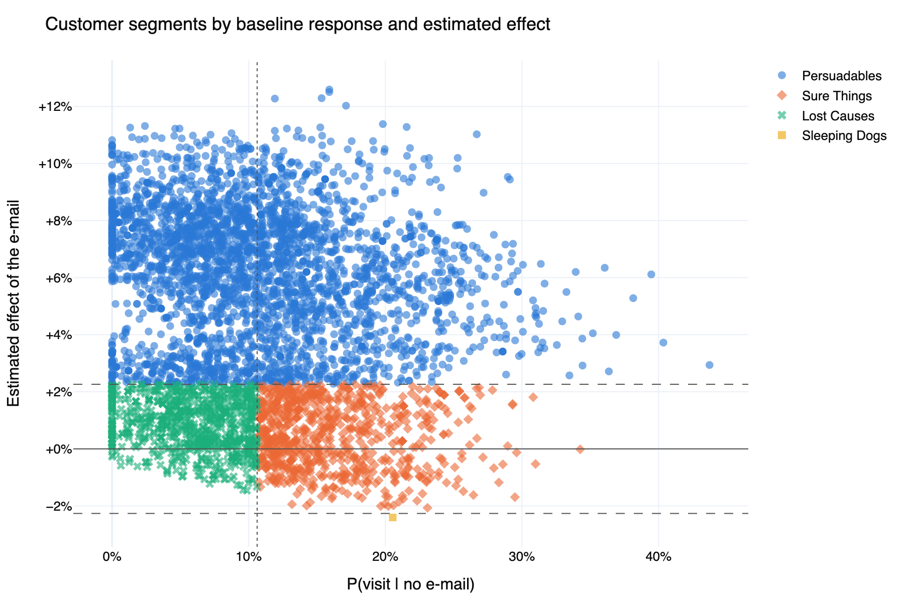
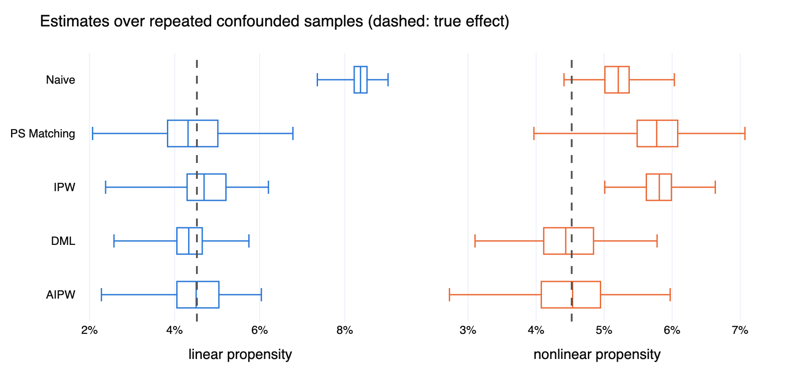
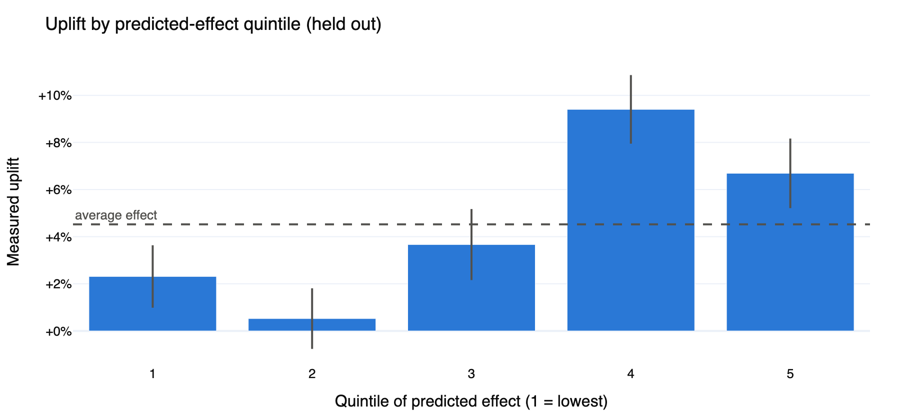

# uplift-causal-marketing

**Did the campaign work, for whom, and whom should we not contact?**
Causal inference and uplift modeling on the Hillstrom e-mail experiment (64k customers) and the Criteo uplift dataset (13.9M users).



**[Rendered notebooks](https://patrickresearch.github.io/uplift-causal-marketing/)** · **[Budget calculator (live)](https://uplift-causal-marketing-umjfz3v95lngvk9quebejc.streamlit.app/)**

## Approach

| Step | Notebook | Method |
|---|---|---|
| ATE in the randomized experiment | [01_experiment](notebooks/01_experiment.ipynb) | Difference in means, Welch CI |
| Confounded observational version | [02_observational](notebooks/02_observational.ipynb) | Covariate-dependent subsampling with known ground truth |
| Correction | 02 | DoWhy backdoor: PS matching, IPW, Double ML (EconML) |
| Robustness | 02 | DoWhy refuters: random common cause, placebo, data subset |
| Heterogeneous effects | [03_uplift](notebooks/03_uplift.ipynb) | T-, X-learner, Causal Forest (LightGBM base models) |
| Uplift evaluation | 03 | Normalized Qini with Poisson-bootstrap CIs, effect-based segments, budget table with CIs |
| Scale | [04_criteo](notebooks/04_criteo.ipynb) | T-, X-learner on 2M users |
| Robustness | [05_robustness](notebooks/05_robustness.ipynb) | 200 repeated confounded samples, AIPW, E-value, repeated cross-fitting, BLP and AUTOC tests, FDR-controlled segments, selection-corrected budget optimum |

### Assumptions



The correction in 02 is only valid under no unobserved confounding, overlap and SUTVA.
The biased dataset is built so these hold by construction, which is what makes the true effect known: each RCT unit is kept with probability `e(x)·m/p` (treated) or `(1−e(x))·m/(1−p)` (control), giving `P(kept | x) = m` and `P(T=1 | x, kept) = e(x)`.

Bootstrap CIs for IPW and matching keep the fitted propensity fixed. For IPW this is conservative (Hirano, Imbens & Ridder 2003); for matching the bootstrap is not formally valid (Abadie & Imbens 2008), so DML with its analytic CI is the primary estimate. The [coverage measured over 200 samples](#how-solid-are-these-results) agrees: 97 % for IPW and DML, 89 % for matching.

Segments are defined on the estimated effect τ̂(x), not on response levels: *Persuadables* τ̂ > δ, *Sleeping Dogs* τ̂ < −δ, otherwise *Sure Things* or *Lost Causes* by baseline response, with δ = ATE/2. Each segment's uplift is re-measured on held-out data.

## Results

**Experiment (Hillstrom, women's e-mail → visit).** ATE +4.5 pp (95 % CI 3.9–5.2) on a 10.6 % baseline.

**Observational version.** Confounding on recency and purchase history (standardized mean difference ≈ 1.0) nearly doubles the naive estimate:

| | Estimate | 95 % CI | Bias |
|---|---|---|---|
| Naive difference | 8.7 pp | 7.8–9.6 | +4.2 |
| PS matching | 5.5 pp | 4.2–7.0 | +1.0 |
| IPW | 5.3 pp | 3.9–6.5 | +0.8 |
| Double ML | 4.8 pp | 3.6–6.0 | +0.3 |

All refuters pass: placebo treatment −0.02 pp, random common cause and data subsets leave the estimate unchanged.

The table is one confounded sample. The differences in bias between the three corrections are sampling noise, see below.

**Uplift.** Normalized Qini on held-out data:

| | Hillstrom | Criteo (2M) |
|---|---|---|
| T-learner | 0.043 (0.015–0.068) | 0.072 (0.060–0.082) |
| X-learner | 0.043 (0.017–0.068) | 0.076 (0.066–0.087) |
| Causal Forest | 0.063 (0.040–0.088) | – |



**Targeting.** Contacting only the top 30 % by predicted uplift captures **53 % (43–65 %)** of the incremental visits on Hillstrom and **79 % (71–85 %)** on Criteo, where the effect is far more concentrated (top 10 % → 53 %).

**Segments.** On Hillstrom, 16 % of customers are *Sure Things*: they visit anyway and the e-mail adds nothing measurable (+0.3 pp, CI −2.3 to 2.8). Skipping them saves 16 % of the contact cost at no measurable loss. *Sleeping Dogs* are practically absent (0.02 %): for visits, an e-mail rarely hurts.



## How solid are these results?

[05_robustness](notebooks/05_robustness.ipynb) repeats what the notebooks above do once.

**Estimators over 200 confounded samples** (`make mc`). *Linear*: the propensity is logistic in recency and purchase history, as above. *Nonlinear*: it depends on their squares, which a logistic propensity model in the raw covariates cannot represent. True effect 4.5 pp.

| | Linear: bias | RMSE | 95 % CI coverage | Nonlinear: bias | RMSE | 95 % CI coverage |
|---|---|---|---|---|---|---|
| Naive difference | +3.8 pp | 3.9 | 0 % | +0.7 pp | 0.7 | 84 % |
| PS matching | −0.1 pp | 0.9 | 89 % | +1.3 pp | 1.3 | 37 % |
| IPW | +0.2 pp | 0.7 | 97 % | +1.3 pp | 1.3 | 11 % |
| Double ML | −0.2 pp | 0.6 | 97 % | −0.0 pp | 0.5 | 98 % |
| AIPW (cross-fitted) | +0.0 pp | 0.7 | 96 % | −0.0 pp | 0.6 | 96 % |



- With a correctly specified propensity model all corrections are nearly unbiased. Double ML has the smallest error; the matching bootstrap interval is too narrow.
- With a misspecified propensity model, matching and IPW are **more biased than no adjustment at all** and their intervals almost never contain the truth. Double ML and AIPW, which fit flexible models for both treatment and outcome, are unaffected.

**Unobserved confounding.** If purchase history is left out of the covariates, the Double ML bias on the sample above grows from +0.3 to +1.2 pp. The adjusted effect has an E-value of 2.3 (2.0 for the lower confidence bound): a hidden confounder would need a risk ratio of at least that size with both mailing and visiting to explain the effect away.

**Uplift ranking over repeated cross-fitting** (5 folds × 5 repetitions, all 42,693 customers scored out of fold):

| | Qini, median (range) | Calibration slope | AUTOC |
|---|---|---|---|
| Causal Forest | 0.057 (0.051–0.061) | 0.73 ± 0.09 | 0.020 ± 0.004 |
| S-learner | 0.055 (0.054–0.060) | 0.49 ± 0.08 | 0.020 ± 0.004 |
| T-learner | 0.041 (0.040–0.045) | 0.23 ± 0.05 | 0.018 ± 0.004 |
| X-learner | 0.040 (0.039–0.046) | 0.27 ± 0.05 | 0.018 ± 0.004 |
| DR-learner | 0.041 (0.039–0.044) | 0.22 ± 0.04 | 0.016 ± 0.004 |

- Heterogeneity is real: slope and AUTOC are more than four standard errors above zero for every learner.
- The causal forest ranks better than the T-, X- and DR-learner (paired bootstrap of the Qini difference excludes zero) and is not distinguishable from the S-learner (difference 0.004, CI −0.004 to 0.014).
- A slope of 1 would mean calibrated effect sizes. All learners overstate the spread of effects, the T-, X- and DR-learner by a factor of about four.
- The ranking separates the top 40 % from the rest but is not monotone within either group:



**Segments under a 10 % false discovery rate.** Requiring a significant causal-forest effect instead of a point estimate above δ leaves 55 % *Persuadables* (+6.9 pp, CI 5.5–8.3) and raises *Sure Things* from 16 % to 24 % (+1.6 pp, CI −0.6 to 3.7). No customer group has a detectably negative effect.

## Budget calculator

[Live app](https://uplift-causal-marketing-umjfz3v95lngvk9quebejc.streamlit.app/) · local: `make app`

`app/streamlit_app.py` turns held-out uplift scores into a profit curve: set customer base, cost per contact, value per incremental visit and budget; it returns the optimal target share, expected incremental visits and profit with 95 % bootstrap bands. Scores are exported by notebooks 03/04 to `app/scores_*.parquet`, so the app needs no model training and only light dependencies (`app/requirements.txt`).

The optimal share is the maximum of an estimated curve, so its profit is biased upwards. The app also reports a corrected value: the share is chosen on each bootstrap sample and scored on the customers left out of it. On Hillstrom at €0.10 per contact and €5 per visit this lowers the expected profit by 13 %, and the optimal share is only known to lie between 50 % and 99 %.

## Setup

```bash
brew install libomp   # LightGBM on macOS
make setup            # uv sync + Chrome for static plotly export
make test
make mc               # 200 confounded samples per scenario, about 10 min on 10 cores
make docs             # executes notebooks, renders HTML to docs/
```

Data is downloaded on first use and cached as parquet in `data/`.

## Structure

```
src/uplift_causal/
  data.py             loaders + parquet cache
  simulate_bias.py    confounded subsample with preserved ATE
  estimate.py         DoWhy estimators + refuters, cross-fitted AIPW
  montecarlo.py       estimators over repeated confounded samples
  sensitivity.py      E-value, robustness value
  learners.py         meta-learners, causal forest, repeated cross-fitting
  evaluate_uplift.py  Qini/uplift curves, BLP and RATE tests, GATES, segments, budget table
  plots.py
results/              Monte Carlo runs and summary
app/                  Streamlit budget calculator + exported scores
notebooks/            thin: call src, show results
docs/                 rendered notebooks + figures
```

## References

- Hillstrom, K. (2008). *The MineThatData E-Mail Analytics and Data Mining Challenge.*
- Diemert, E. et al. (2018). *A Large Scale Benchmark for Uplift Modeling.* AdKDD. Data: [criteo/criteo-uplift](https://huggingface.co/datasets/criteo/criteo-uplift), CC BY-NC-SA 4.0.
- Künzel, S. et al. (2019). *Metalearners for estimating heterogeneous treatment effects using machine learning.* PNAS.
- Chernozhukov, V. et al. (2018). *Double/debiased machine learning for treatment and structural parameters.* Econometrics Journal.
- Wager, S. & Athey, S. (2018). *Estimation and Inference of Heterogeneous Treatment Effects using Random Forests.* JASA.
- Radcliffe, N. (2007). *Using control groups to target on predicted lift.* DMA Analytics Annual.
- Chernozhukov, V. et al. (2018). *Generic Machine Learning Inference on Heterogeneous Treatment Effects in Randomized Experiments.* NBER.
- Yadlowsky, S. et al. (2025). *Evaluating Treatment Prioritization Rules via Rank-Weighted Average Treatment Effects.* JASA.
- VanderWeele, T. & Ding, P. (2017). *Sensitivity Analysis in Observational Research: Introducing the E-Value.* Annals of Internal Medicine.

## License

MIT
